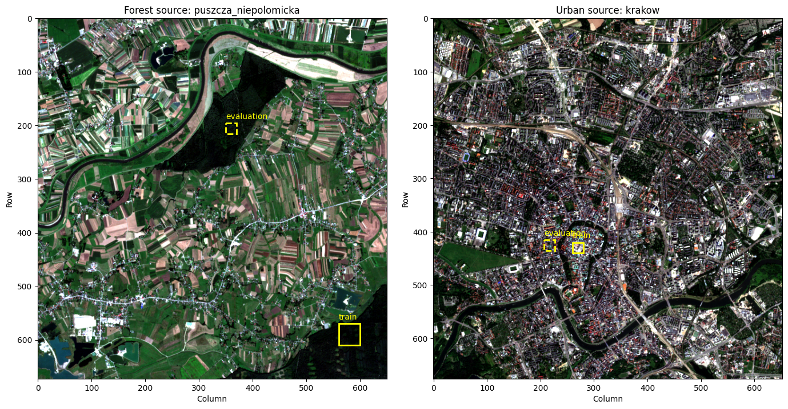
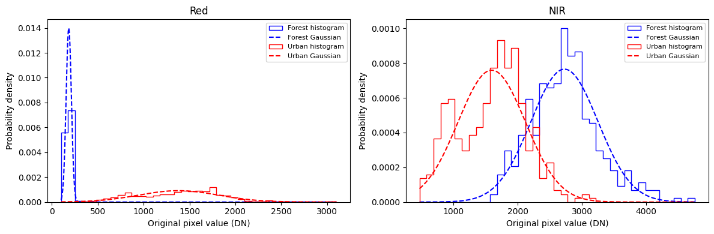
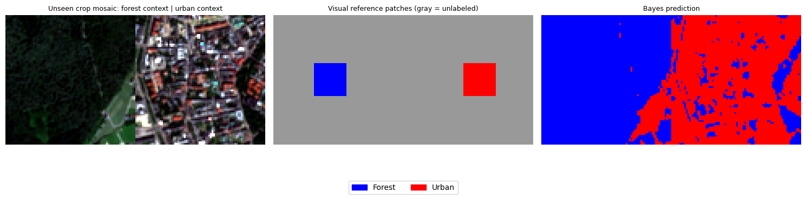
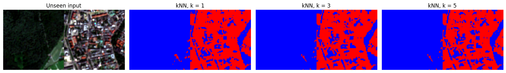

# Lab 3: Bayes and kNN classifiers

For this exercise I've used the Sentinel-2 images from lab 2, with Puszcza Niepolomicka as the forest scene and Krakow as the urban scene  Each pixel is represented by its original red and near-infrared (NIR) values  Both classifiers use the same pixels, with forest shown in blue and urban in red

## Training data

Both scenes contain different land covers, so I've selected small patches that visually represent forest and urban areas  From each patch I randomly sample 400 valid pixels using a fixed seed, giving 800 training pixels in total  The red and NIR values form the two features for each pixel

The test image is made by joining two separate crops from the same scenes  These crops do not overlap the training patches  I also selected one 20 by 20 reference patch in each crop and assigned its label by looking at the image  The RGB stretch is only used for display, the classifiers use the original band values

In the figure the solid rectangles mark training patches and the dashed rectangles mark the reference patches

## Bayes classifier

I've plotted the red and NIR histograms for the training pixels and fitted a two-dimensional Gaussian PDF to each class  The mean gives the center of the distribution and the covariance describes how the two bands vary, including their relationship with each other  I add a small value to the covariance diagonal so the matrix can be inverted

The fitted parameters are in red, NIR order and the covariance matrices include the small diagonal adjustment

| Class | Mean [red, NIR] | Covariance matrix |
| --- | --- | --- |
| Forest | [185.69, 2727.44] | [[813.24, 1735.58], [1735.58, 272099.99]] |
| Urban | [1381.13, 1595.92] | [[190795.12, 202739.13], [202739.13, 276269.39]] |

For each valid test pixel I calculate the Gaussian likelihood for both classes, combine each with its prior and select the larger score  I use equal priors of 0.5 and equal error costs, with log scores to keep the calculation stable  The red band separates the selected classes more clearly than NIR, though the Gaussian curves miss some peaks and tails

$$\hat c = \arg\max_c [\log p(x\mid c) + \log P(c)]$$

The figure shows the test mosaic, the reference patches and the Bayes prediction  Gray in the reference map means unlabeled, while gray in a prediction map means missing data

The model assigns every valid pixel to one of the two classes, including other land covers such as fields and paths  I've implemented the Gaussian model and Bayes decision in [bayes_classifier.py](bayes_classifier.py), with the PDF and decision rule described in the Penn State notes on [multivariate normal distributions](https://online.stat.psu.edu/stat505/Lesson04) and [Bayes classification](https://online.stat.psu.edu/stat857/node/17/)

## kNN classifier

I've used the same training pixels and red and NIR bands for kNN  First I calculate the mean and standard deviation of each feature from the training set, then use them to standardize both training and test pixels

For each test pixel I calculate its squared Euclidean distance to the training pixels, select the k nearest and assign the majority class  I repeat this for k = 1, 3 and 5, processing pixels in batches to limit memory use  The implementation is in [knn_classifier.py](knn_classifier.py)

## Results

I compare the predictions with the 800 visually labeled reference pixels, split evenly between forest and urban

| Classifier | Accuracy | Forest recall | Urban recall |
| --- | ---: | ---: | ---: |
| Bayes | 92.9% | 100.0% | 85.8% |
| kNN, k = 1 | 89.0% | 100.0% | 78.0% |
| kNN, k = 3 | 87.9% | 100.0% | 75.8% |
| kNN, k = 5 | 87.1% | 100.0% | 74.3% |

Bayes gives the highest accuracy on these patches  All four predictions classify the forest reference patch correctly, while the errors are urban reference pixels classified as forest  I think the urban patch is harder to represent because it contains different surfaces

Increasing k gives individual training pixels less influence, but the accuracy falls on these patches  The maps change for 1.35% of valid pixels between k = 1 and 3, and for 0.73% between k = 3 and 5  Of these values, k = 1 gives the best kNN accuracy for the selected patches

The reference labels are visual estimates and cover only a small part of the mosaic  Since the test crops come from the same scenes as the training patches, these scores do not show how well the models work on a separate acquisition
